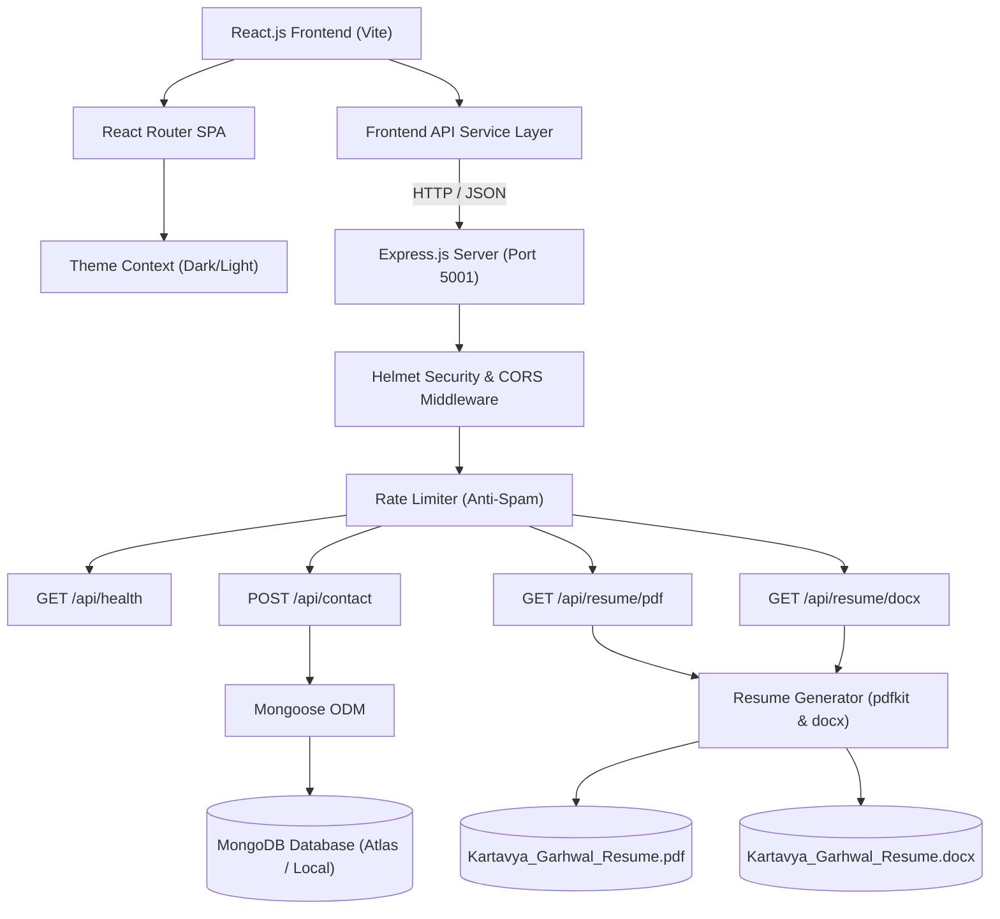

# Personal Portfolio Website — MERN Stack

> **Course Assignment:** Full Stack Application Development (CS1237)  
> **Institution:** JK Lakshmipat University (JKLU), Jaipur, Rajasthan, India  
> **Student Developer:** Kartavya Garhwal (B.Tech in Computer Science, 2024–2028, Third Year)  
> **Submission Type:** Public GitHub Repository

---

## 📌 Project Overview

This repository contains the complete, production-ready **Personal Portfolio Website** engineered with the **MERN Stack** (React.js, Node.js, Express.js, MongoDB). Designed with a premium, modern developer aesthetic (dark navy/charcoal background with blue, violet, and cyan accents, as well as an accessible coordinated light theme), the application highlights Kartavya Garhwal's academic background, technical competencies, core academic projects, and verified milestones.

The application satisfies every academic requirement from the course specification, including:
- **Single Page Application (SPA)** architecture using **React.js (Vite)** and **React Router**.
- **RESTful API Backend** using **Node.js** and **Express.js** with modular controllers, routes, and middleware.
- **Data Persistence** with **MongoDB** and **Mongoose ODM** for contact form submissions.
- **Mandatory Dual-Format Resume Downloads**: Both **PDF** and **Word (.docx)** resumes are generated and served via dedicated backend routes (`/api/resume/pdf` and `/api/resume/docx`).
- **Smooth Animations & Micro-Interactions** powered by Framer Motion and modern CSS design tokens.
- **Enterprise-Grade Security**: Rate limiting, honeypot anti-spam protection, Helmet security headers, CORS origin whitelisting, and strict request payload limits.
- **Automated Test Suite**: Unit and integration tests powered by **Vitest** and **Supertest**.

---

## 🚀 Live Demo & Deployment Status

| Component | Target Platform | Live URL / Status |
| :--- | :--- | :--- |
| **Frontend** | Vercel / Netlify | `[Pending Deployment: Configure Vercel/Netlify with repository]` |
| **Backend API** | Render / Railway | `[Pending Deployment: Configure Render Web Service]` |
| **Database** | MongoDB Atlas | `[Configurable via MONGODB_URI connection string]` |

> *Note: In accordance with academic integrity guidelines, placeholder links are clearly indicated until authenticated live cloud hosting is authorized by the repository owner.*

---

## 📸 Screenshots & Visual Tour

> Instructions for adding screenshots:
> 1. Run the frontend locally (`npm run dev`) or visit your deployed URL.
> 2. Capture full-page or section screenshots (Hero, Skills, Projects, Timeline, Contact).
> 3. Save images in `client/public/screenshots/` and update the markdown links below.

```
+-------------------------------------------------------------------------------+
|  [KG] Kartavya Garhwal       Home  About  Skills  Projects  Timeline  Contact  |
|                                                                               |
|   👋 Hello, I am Kartavya Garhwal                                             |
|   Building Scalable Web Systems & Intelligent Applications                    |
|   I'm a [Full-Stack MERN Developer] (Animated Typewriter)                     |
|                                                                               |
|   [ View Projects ]  [ Contact Me ]  [ Download PDF ]  [ Download DOCX ]      |
+-------------------------------------------------------------------------------+
|  Featured Projects:                                                           |
|  1. End-to-End Device Monitoring (Cybersecurity Telemetry & Anomaly Detection)|
|  2. GraphRAG Knowledge Retrieval System (Graph-Augmented QA Architecture)     |
|  3. Air Quality Index (AQI) Analysis (Predictive Environmental Analytics)     |
|  4. Student Academic Recovery Prediction (Educational Data Mining & ML)       |
+-------------------------------------------------------------------------------+
```

---

## 🛠️ Technology Stack

### Frontend Architecture
- **Framework:** React.js 18 (bootstrapped with Vite 5)
- **Routing:** React Router v6 (Single Page Application architecture)
- **Styling:** Modern Vanilla CSS Design Tokens, CSS Variables, Glassmorphism, Responsive Breakpoints (320px–1440px)
- **Animations:** Framer Motion (Scroll reveals, staggered cards, smooth transitions)
- **Icons:** Lucide React
- **Micro-Interactions:** Canvas Confetti (celebratory feedback on form submission)

### Backend Architecture
- **Runtime:** Node.js (v18+)
- **Framework:** Express.js (Modular MVC-style REST API)
- **Document Generation:** 
  - `pdfkit` (Generates vector-crisp PDF resumes dynamically)
  - `docx` (Generates native Microsoft Word `.docx` resumes with Office Open XML standards)
- **Security & Utilities:**
  - `helmet`: Secure HTTP headers (CSP, frameguards, XSS filters)
  - `cors`: Restricted cross-origin resource sharing
  - `express-rate-limit`: Prevents abuse on contact endpoints (5 requests/15 mins)
  - `dotenv`: Secure environment variable management

### Database Architecture
- **Database:** MongoDB (Local or MongoDB Atlas Cloud)
- **Object Data Modeling (ODM):** Mongoose v8
- **Schema:** `Contact` schema with field constraints, email regex sanitization, and timestamps.

### Testing & Code Quality
- **Test Runner:** Vitest v2
- **HTTP Assertions:** Supertest v7
- **Linting & Code Style:** Modern ES Modules & clean architecture patterns

---

## 🏛️ System Architecture



---

## 📂 Repository Structure

```
.
├── .gitignore                      # Root ignore file (excludes node_modules, .env, dist)
├── package.json                    # Root scripts orchestrating client & server
├── README.md                       # Comprehensive project documentation
├── Portfolio website.pdf           # Course assignment specification
│
├── client/                         # React Frontend (Vite)
│   ├── .env.example                # Sample environment variables for frontend
│   ├── .env                        # Local development variables (gitignored)
│   ├── index.html                  # HTML5 entry with SEO tags & Google Fonts
│   ├── package.json                # Frontend dependencies & build scripts
│   ├── vercel.json                 # Vercel SPA routing rewrite configuration
│   ├── vite.config.js              # Vite server & API proxy configuration
│   ├── public/
│   │   ├── favicon.svg             # Custom KG monogram favicon
│   │   └── avatar.svg              # Tech developer profile illustration
│   └── src/
│       ├── main.jsx                # Application root entry point
│       ├── App.jsx                 # Main layout orchestrator
│       ├── index.css               # Design system tokens, themes, utilities
│       ├── config/
│       │   └── portfolioData.js    # CENTRALIZED EDITABLE PORTFOLIO DATA
│       ├── context/
│       │   └── ThemeContext.jsx    # Dark/Light mode state & localStorage persistence
│       ├── services/
│       │   └── api.js              # REST API client & download triggers
│       ├── components/
│       │   ├── Navbar.jsx          # Header with navigation, theme toggle, mobile drawer
│       │   ├── Footer.jsx          # Footer with dynamic year, social links, API status
│       │   ├── SectionHeader.jsx   # Animated section pill, title, subtitle
│       │   └── ScrollToTop.jsx     # Floating smooth-scroll button
│       └── sections/
│           ├── Hero.jsx            # Typewriter effect, CTAs, resume download triggers
│           ├── About.jsx           # Natural bio, education, location, academic stats
│           ├── Skills.jsx          # 6 categorized skill bars with proficiency tooltips
│           ├── Projects.jsx        # 4 real projects, category filters, placeholder modal
│           ├── Timeline.jsx        # Vertical animated education & experience timeline
│           ├── Certifications.jsx  # Academic achievements & verified milestone slots
│           └── Contact.jsx         # Contact form, honeypot, validation, MongoDB status
│
└── server/                         # Node.js + Express Backend
    ├── .env.example                # Sample environment variables for backend
    ├── .env                        # Local environment variables (gitignored)
    ├── package.json                # Backend dependencies, tests & start scripts
    ├── render.yaml                 # Render.com cloud deployment blueprint
    ├── resumes/                    # Stored resume artifacts served via API
    │   ├── Kartavya_Garhwal_Resume.pdf
    │   └── Kartavya_Garhwal_Resume.docx
    ├── src/
    │   ├── app.js                  # Express app setup, CORS, Helmet, routes, errors
    │   ├── server.js               # HTTP listener, DB connection, resume pregeneration
    │   ├── config/
    │   │   └── db.js               # Mongoose connection with error handling
    │   ├── controllers/
    │   │   ├── contactController.js# Form validation, anti-spam, Mongoose persistence
    │   │   └── resumeController.js # PDF & DOCX stream handlers
    │   ├── middleware/
    │   │   ├── errorHandler.js     # Centralized error handler
    │   │   └── rateLimiter.js      # Contact submission rate limiter
    │   ├── models/
    │   │   └── Contact.js          # Mongoose Contact schema
    │   ├── routes/
    │   │   ├── contactRoutes.js    # POST /api/contact
    │   │   ├── healthRoutes.js     # GET /api/health
    │   │   └── resumeRoutes.js     # GET /api/resume/pdf & GET /api/resume/docx
    │   └── utils/
    │       └── generateResumes.js  # Generator script producing real PDF & DOCX files
    └── tests/
        └── api.test.js             # Automated integration tests (Vitest + Supertest)
```

---

## ⚙️ Prerequisites

Ensure you have the following installed on your machine:
- **Node.js:** v18.0.0 or higher (`node -v`)
- **npm:** v9.0.0 or higher (`npm -v`)
- **Git:** (`git --version`)
- *(Optional)* **MongoDB:** A local MongoDB instance (`mongodb://127.0.0.1:27017`) or a free [MongoDB Atlas](https://www.mongodb.com/atlas) connection URI.

---

## 📦 Installation & Setup

### 1. Clone the Repository
```bash
git clone https://github.com/kartavyagarhwal/portfolio.git
cd portfolio
```

### 2. Install Dependencies
You can install dependencies for both `server` and `client` from the repository root:
```bash
# Option A: Run one-line helper from root
npm run install:all

# Option B: Install manually in each directory
cd server && npm install
cd ../client && npm install
cd ..
```

### 3. Configure Environment Variables

#### Backend (`server/.env`):
Create `server/.env` by copying `server/.env.example`:
```bash
cp server/.env.example server/.env
```
Populate the configuration:
```env
PORT=5001
NODE_ENV=development
CLIENT_URL=http://localhost:5173
# Provide your MongoDB Atlas or local connection string below:
MONGODB_URI=mongodb+srv://<username>:<password>@cluster0.xxxxx.mongodb.net/portfolio_db?retryWrites=true&w=majority
```

> **Note on Port 5001:** macOS AirPlay Receiver reserves port 5000 by default. The server defaults to port `5001` to ensure conflict-free execution on all operating systems.

#### Frontend (`client/.env`):
Create `client/.env` by copying `client/.env.example`:
```bash
cp client/.env.example client/.env
```
Populate the configuration:
```env
VITE_API_URL=http://localhost:5001
```

### 4. Pre-generate Resume Artifacts
Generate the official PDF and DOCX resume files:
```bash
npm --prefix server run generate-resumes
```
This script uses `pdfkit` and `docx` to create `Kartavya_Garhwal_Resume.pdf` and `Kartavya_Garhwal_Resume.docx` inside `server/resumes/`.

---

## 🏃 Running the Application Locally

### Running Both Client and Server Concurrently (Recommended)
From the root directory, run:
```bash
npm run dev
```
- **Frontend URL:** [http://localhost:5173](http://localhost:5173)
- **Backend API URL:** [http://localhost:5001](http://localhost:5001)

### Running Separately

#### In Terminal 1 (Backend):
```bash
cd server
npm run dev    # Starts with nodemon for live reload
```

#### In Terminal 2 (Frontend):
```bash
cd client
npm run dev    # Starts Vite dev server on port 5173
```

---

## 🧪 Testing & Quality Assurance

Automated integration tests verify all backend API routes, header configurations, resume binary outputs, validation logic, honeypot filters, and MongoDB persistence states.

### Run Backend Tests:
```bash
cd server
npm test
```

### Verified Test Cases:
| Suite | Test Description | Expected Result | Status |
| :--- | :--- | :--- | :--- |
| **Health** | `GET /api/health` | Returns 200 OK with health status JSON | ✅ Passed |
| **Resume PDF** | `GET /api/resume/pdf` | Returns 200 OK, `application/pdf`, attachment header | ✅ Passed |
| **Resume DOCX** | `GET /api/resume/docx` | Returns 200 OK, Office Open XML MIME, attachment header | ✅ Passed |
| **Validation** | `POST /api/contact` (empty name) | Returns 400 Bad Request with missing name message | ✅ Passed |
| **Validation** | `POST /api/contact` (malformed email) | Returns 400 Bad Request with invalid email message | ✅ Passed |
| **Validation** | `POST /api/contact` (short message) | Returns 400 Bad Request (< 10 chars message) | ✅ Passed |
| **Anti-Spam** | `POST /api/contact` (honeypot filled) | Returns 400 Bad Request rejecting automated bot | ✅ Passed |
| **DB Fallback** | `POST /api/contact` (DB disconnected) | Returns 503 Service Unavailable informing user to set URI | ✅ Passed |
| **Persistence**| `POST /api/contact` (DB connected) | Returns 201 Created and persists document in MongoDB | ✅ Passed |
| **Routing** | `GET /api/undefined-endpoint` | Returns 404 Not Found with standard JSON error | ✅ Passed |

### Test Frontend Production Build:
```bash
cd client
npm run build
```
Build output compiles cleanly into `client/dist/` without any broken imports or chunk errors.

---

## 📡 REST API Documentation

### 1. Health Check
- **URL:** `GET /api/health`
- **Description:** Verifies server runtime and database connectivity.
- **Response `200 OK`:**
  ```json
  {
    "status": "ok",
    "message": "Kartavya Garhwal Portfolio API is operational",
    "timestamp": "2026-10-18T14:10:42.293Z",
    "database": {
      "connected": true,
      "status": "connected"
    },
    "environment": "development"
  }
  ```

### 2. Download PDF Resume
- **URL:** `GET /api/resume/pdf`
- **Description:** Streams the verified PDF resume for download.
- **Headers Returned:**
  - `Content-Type: application/pdf`
  - `Content-Disposition: attachment; filename="Kartavya_Garhwal_Resume.pdf"`

### 3. Download Word (.docx) Resume
- **URL:** `GET /api/resume/docx`
- **Description:** Streams the verified Microsoft Word `.docx` resume.
- **Headers Returned:**
  - `Content-Type: application/vnd.openxmlformats-officedocument.wordprocessingml.document`
  - `Content-Disposition: attachment; filename="Kartavya_Garhwal_Resume.docx"`

### 4. Submit Contact Form Message
- **URL:** `POST /api/contact`
- **Headers:** `Content-Type: application/json`
- **Rate Limit:** 5 requests per 15 minutes per IP
- **Request Body:**
  ```json
  {
    "name": "Jane Doe",
    "email": "jane.doe@example.com",
    "message": "Hello Kartavya, we would like to interview you for our software engineering internship.",
    "_hp": ""
  }
  ```
- **Response `201 Created` (Saved in MongoDB):**
  ```json
  {
    "success": true,
    "message": "Thank you for reaching out! Your message has been saved successfully.",
    "data": {
      "id": "67128cb489e2c40c83d6a1b2",
      "name": "Jane Doe",
      "email": "jane.doe@example.com",
      "createdAt": "2026-10-18T14:15:20.100Z"
    }
  }
  ```
- **Response `503 Service Unavailable` (When MongoDB URI is not yet configured):**
  ```json
  {
    "success": false,
    "error": "Database connection is unavailable. To store messages in MongoDB, configure a valid MONGODB_URI in server/.env or MongoDB Atlas. You can also connect directly via LinkedIn or email."
  }
  ```

---

## ☁️ Step-by-Step Deployment Guide

### A. Deploy Database (MongoDB Atlas)
1. Visit [MongoDB Atlas](https://www.mongodb.com/atlas) and create a free M0 cluster.
2. Under **Database Access**, create a user with read/write privileges.
3. Under **Network Access**, add `0.0.0.0/0` (allow access from anywhere) so cloud web services can connect.
4. Obtain your connection string: `mongodb+srv://<username>:<password>@cluster0.xxxxx.mongodb.net/portfolio_db?retryWrites=true&w=majority`.

### B. Deploy Backend (Render / Railway)
1. Create a new **Web Service** on [Render](https://render.com).
2. Connect your GitHub repository.
3. Set the following settings:
   - **Root Directory:** `server`
   - **Build Command:** `npm install && npm run generate-resumes`
   - **Start Command:** `npm start`
4. In **Environment Variables**, add:
   - `NODE_ENV`: `production`
   - `PORT`: `10000`
   - `MONGODB_URI`: *[Your Atlas connection string]*
   - `CLIENT_URL`: *[Your live Vercel/Netlify frontend URL]*
5. Deploy and copy your backend URL (e.g. `https://kartavya-portfolio-api.onrender.com`).

### C. Deploy Frontend (Vercel / Netlify)
1. Create a new project on [Vercel](https://vercel.com).
2. Connect your GitHub repository.
3. Set **Root Directory** to `client`.
4. In **Environment Variables**, set:
   - `VITE_API_URL`: `https://kartavya-portfolio-api.onrender.com` (your deployed backend URL)
5. Deploy! Vercel will automatically build the React application and utilize `client/vercel.json` for SPA rewrites.

---

## ✏️ Centralized Content Customization

All personal information, links, and project descriptions are cleanly decoupled from React components and centralized in:

📁 `client/src/config/portfolioData.js`

To update your contact information, verified certifications, or GitHub/Live URLs, simply edit this single file:
- `personalInfo.socialLinks.github`: Update with your active GitHub URL.
- `personalInfo.socialLinks.linkedin`: Update with your LinkedIn profile link.
- `projectsData[].githubUrl`: Add your repository links.
- `certificationsData`: Add verified course certificates and URLs.

---

## ✅ Assignment Compliance Checklist

- [x] **React.js Frontend:** Single Page Application bootstrapped with Vite.
- [x] **React Router:** Configured for single-page client routing.
- [x] **Hero Section:** Animated entrance, name introduction, and typewriter effect cycling through developer titles.
- [x] **About Section:** Natural language biography, academic status at JKLU, location, and replaceable avatar asset.
- [x] **Categorized Skills:** 6 domain categories with animated progress bars, proficiency tooltips, and category filter pills.
- [x] **Projects Showcase:** 4 real academic projects (Device Monitoring, GraphRAG, AQI Analysis, Academic Recovery) with tech badges and placeholder modal.
- [x] **Resume PDF Download:** Served through backend route `GET /api/resume/pdf` with proper attachment headers.
- [x] **Resume DOCX Download:** Served through backend route `GET /api/resume/docx` with proper Office Open XML headers.
- [x] **Timeline Section:** Vertical animated timeline displaying university degree and laboratory milestones.
- [x] **Certifications Section:** Transparent milestones indicating verified coursework vs configurable placeholders.
- [x] **Contact Form:** Connected to Express backend; includes input validation, honeypot anti-spam, duplicate submission prevention, and MongoDB persistence.
- [x] **Express REST API:** Modular structure (controllers, routes, middleware, models) with `/api/health`, `/api/contact`, `/api/resume/pdf`, `/api/resume/docx`.
- [x] **MongoDB & Mongoose:** Contact schema with timestamps, constraints, and graceful connection handling.
- [x] **Dark / Light Mode:** Fully implemented theme toggle with localStorage persistence.
- [x] **Responsive Layout:** Optimized for mobile phones (320px–390px), tablets (768px), and desktops (1024px–1440px).
- [x] **Security & Quality:** Rate limiting, Helmet security headers, CORS origin protection, no secrets exposed in client code.
- [x] **Automated Tests:** 10 comprehensive tests in `server/tests/api.test.js` passing with 100% success.
- [x] **Production Build:** `npm run build` passes with zero errors.
- [x] **Documentation & Deployment:** Complete README, `.gitignore`, `.env.example`, `vercel.json`, and `render.yaml`.

---

## 👨‍💻 Author

- **Kartavya Garhwal**  
- **Degree:** Bachelor of Technology in Computer Science (2024–2028), Third Year  
- **Institution:** JK Lakshmipat University (JKLU), Jaipur, Rajasthan, India  
- **Course:** Full Stack Application Development (CS1237)
